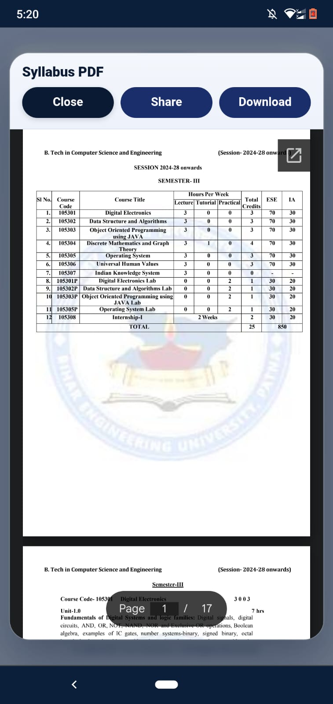

<p align="center">
  
</p>

<h1 align="center">📚 BEU Syllabus App</h1>

<p align="center">
  <b>One place for all Bihar Engineering University (BEU) B.Tech syllabus</b><br>
  Branch-wise • Semester-wise • Session-wise • Installable PWA
</p>

<p align="center">
  <a href="https://mdzafar864.github.io/BEU-Syllabus-App/"></a>
  <a href="./archive/v1.0"></a>
  
  
  
</p>

<p align="center">
  
  
  
  
  
  
</p>

---

## 📑 Table of Contents

- [About](#-about)
- [Features](#-features)
- [Versions](#-versions)
- [Supported Branches & Semesters](#-supported-branches--semesters)
- [Project Architecture](#-project-architecture)
- [Project Structure](#-project-structure)
- [Screenshots](#-screenshots)
- [Getting Started](#-getting-started)
- [Deployment (CI/CD)](#-deployment-cicd)
- [Stats Bar & Usage Tracking](#-stats-bar--usage-tracking)
- [Archive Folder](#-archive-folder)
- [Roadmap](#-roadmap)
- [Contributing](#-contributing)
- [Developer](#-developer)
- [License](#-license)

---

## 📖 About

**BEU Syllabus App** is a **Progressive Web App (PWA)** for students of **Bihar Engineering University (BEU)**. It gives **branch-wise**, **semester-wise** and **session-wise** B.Tech syllabus PDFs with an easy interface. Preview and download the latest syllabus from any device, no login needed.

---

## ✨ Features

| | |
| --- | --- |
| 📚 Branch-wise syllabus | 🎓 Semester & session navigation |
| 📄 In-app PDF preview | 📥 One-click download |
| 📱 Mobile & desktop friendly | 🌐 Installable PWA (works like an app) |
| ⚡ Fast loading with service worker cache | 🔄 Auto-update on every deploy |
| 📊 Live stats bar (Total / Active users, Downloads) | 🔒 Anonymous tracking, no personal data |

---

## 🗂 Versions

| Version | Type | Location | Notes |
| --- | --- | --- | --- |
| **Current (v1.0.x+)** | Static frontend + analytics API | [`/`](./) (root) + [`/server`](./server) | Stats bar, click tracking, MongoDB Atlas |
| **v1.0 (archive)** | ⚡ **Serverless** (frontend only) | [`/archive/v1.0`](./archive/v1.0) | No backend, no database, no stats bar. Only GitHub Pages |

> Want the simplest possible version with zero backend? Use the [serverless v1.0 archive](./archive/v1.0).

---

## 🎓 Supported Branches & Semesters

**Branches:** CSE • IT • AI • AIML • AIDS • Civil (CE) • Mechanical (ME) • Electrical (EE) • ECE • EEE • IoT

**Semesters:** 1st to 8th

---

## 🏗 Project Architecture

```text
                    ┌───────────────────────────────┐
                    │   GitHub Pages (static host)  │
                    │  index.html • css • js • PWA  │
                    └───────────────┬───────────────┘
                                    │
              ┌─────────────────────┴─────────────────────┐
              │                                           │
   Syllabus data (js/data.js)                  tracker.js / stats.js
   semester → session → branch → PDF                      │
                                              POST /api/track
                                              GET  /api/stats
                                                          │
                                              ┌───────────▼───────────┐
                                              │  server/ (Node API)   │
                                              │  Vercel / Render ...  │
                                              └───────────┬───────────┘
                                                          │
                                              ┌───────────▼───────────┐
                                              │    MongoDB Atlas      │
                                              │ events•visitors•counters│
                                              └───────────────────────┘

   archive/v1.0  →  old serverless build (frontend only, no API / DB)
```

**How it works**

1. The frontend is fully static and hosted on **GitHub Pages**.
2. Syllabus links live in `js/data.js` as `syllabus[semester][session][branch] = pdfLink`.
3. `service-worker.js` caches the app for offline-friendly, fast loading. `scripts/build-sw.js` stamps a fresh build id on every deploy so users always get updates.
4. `tracker.js` and `stats.js` talk to the **`server/`** API, which stores anonymous usage data in **MongoDB Atlas**. A static site cannot connect to Atlas directly (the password would be public), so the API sits in between.

---

## 📂 Project Structure

```text
BEU-Syllabus-App
│
├── index.html                 # App entry point (PWA shell + CSP)
├── manifest.json              # PWA manifest
├── service-worker.js          # Offline cache (build id stamped on deploy)
├── version.json               # App version + build id
├── robots.txt                 # SEO
├── sitemap.xml                # SEO
│
├── css/
│   ├── style.css              # Main styles
│   └── stats.css              # Stats bar styles
│
├── js/
│   ├── app.js                 # Core app logic / navigation
│   ├── data.js                # Syllabus data (semester → session → branch → PDF)
│   ├── analytics.js           # Google Analytics 4
│   ├── config.js              # API URL + tracking settings
│   ├── tracker.js             # Click / action tracking → MongoDB + GA4
│   └── stats.js               # Stats bar (Total, Active, Downloads)
│
├── assets/
│   ├── logo.png, Developer.png
│   ├── icon-192/512.png, icon-maskable-192/512.png, apple-touch-icon.png
│   ├── favicon.ico / .svg / -96x96.png
│   └── screenshots/           # README screenshots
│
├── server/                    # Analytics API (Node.js + MongoDB Atlas)
│   ├── api/                   # Vercel functions: track.js, stats.js, health.js
│   ├── src/                   # app, config, db, seed, validate, instance
│   ├── scripts/seed.js        # Manual DB seed
│   ├── server.js              # Local / Node host entry
│   ├── .env.example           # Environment variable template
│   └── README.md              # API documentation
│
├── scripts/
│   └── build-sw.js            # Stamps build id into service-worker.js & version.json
│
├── .github/workflows/
│   └── deploy.yml             # Build + deploy to GitHub Pages
│
└── archive/                   # 🗄 Store folder (old versions)
    ├── .nojekyll              # Tells GitHub Pages to skip Jekyll processing here
    └── v1.0/                  # ⚡ Serverless version (frontend only)
        ├── index.html, manifest.json, service-worker.js, version.json
        ├── css/style.css
        ├── js/ (app.js, analytics.js, data.js)
        ├── assets/
        ├── scripts/build-sw.js
        └── .github/workflows/deploy.yml
```

---

## 📸 Screenshots

<table align="center">
  <tr>
    <td align="center"><b>🏠 Home</b><br><br></td>
    <td align="center"><b>📂 Branch</b><br><br></td>
    <td align="center"><b>🎓 Semester</b><br><br></td>
  </tr>
  <tr>
    <td align="center"><b>📅 Session</b><br><br></td>
    <td align="center"><b>📄 PDF Viewer</b><br><br></td>
    <td align="center"><b>👨‍💻 Developer Info</b><br><br></td>
  </tr>
</table>

---

## 🚀 Getting Started

### Run the frontend

```bash
git clone https://github.com/mdzafar864/BEU-Syllabus-App.git
cd BEU-Syllabus-App
```

Open `index.html`, or serve it locally (recommended, needed for the service worker):

```bash
npx serve .
```

### Run the analytics API locally (optional)

```bash
cd server
cp .env.example .env      # add your MongoDB Atlas details
npm install
npm run dev
```

Check it at `http://localhost:3000/api/health`.

### Use the serverless version (no backend)

```bash
cd archive/v1.0
npx serve .
```

---

## 🔄 Deployment (CI/CD)

Pushing to `main` runs [`.github/workflows/deploy.yml`](./.github/workflows/deploy.yml), which:

1. Checks out the repo and sets up Node 22.
2. Runs `node scripts/build-sw.js` to stamp a fresh **build id** into `service-worker.js` and `version.json` (deployed copy only, nothing is committed back).
3. Removes `scripts`, `.github` and `.git` from the published output.
4. Uploads and deploys to **GitHub Pages**.

Bump the patch version when releasing:

```bash
node scripts/build-sw.js --bump     # 1.0.2 -> 1.0.3
```

---

## 📊 Stats Bar & Usage Tracking

A stats bar under the **Install / App Mode Active** button shows **Total Users**, **Active Users** and **Downloads**. Every button click, dropdown change and app action is saved to **MongoDB Atlas**, next to the existing **Google Analytics 4** tracking.

```text
Browser (GitHub Pages) ──► server/ API (Vercel / Render / ...) ──► MongoDB Atlas
   tracker.js, stats.js        POST /api/track   GET /api/stats
```

### Setup (about 10 minutes)

1. **Atlas:** create a free cluster and a database user. Under *Network Access* allow your API host (Vercel needs `0.0.0.0/0`, so use a strong password).
2. **Deploy `server/`** to Vercel (Root Directory = `server`) or any Node host, using the variables from [`server/.env.example`](./server/.env.example). Open `https://YOUR-API/api/health` to verify.
3. **Point the app at it** (same URL in both places):
   - `js/config.js` → `apiBase: "https://YOUR-API"`
   - `index.html` → add the same origin to `connect-src` in the Content Security Policy.
4. Push. Until `apiBase` is set, tracking is off and the bar shows `—`.

The API creates its collections, indexes and default documents automatically on first connection to an empty database. More details: [`server/README.md`](./server/README.md).

### What is stored

| Collection | Holds |
| --- | --- |
| `events` | One row per click / change / action (`type`, `name`, `data`, `visitorId`, `sessionId`, time). Auto-deleted after `EVENT_TTL_DAYS` (default 180). |
| `visitors` | One row per anonymous browser id: first / last seen, language, screen. Powers Total and Active users. |
| `counters` | Running Downloads total (kept even after old events expire). |

- **Total users** = distinct anonymous browser ids.
- **Active users** = visitors whose page is open and in the foreground. A heartbeat every 20 s (`heartbeatMs`) keeps them counted; closing or backgrounding the page removes them immediately. `ACTIVE_WINDOW_MINUTES` (default 1) is the safety net for crashed tabs or lost connections.
- **Downloads** = presses of the Download button in the PDF viewer.
- 🔒 **Privacy:** no names, emails or IP addresses are stored. The id is a random value in `localStorage`; clearing site data creates a new one.
- Event types in `events`: `click`, `change`, `action` (mirrored GA4 events), `page_view`, `session_start`.
- Raw clicks and dropdown changes also go to GA4 as `ui_click` / `ui_select_change`. Set `mirrorUiEventsToGA: false` in `js/config.js` to turn that off.

---

## 🗄 Archive Folder

The [`archive/`](./archive) folder is a **store folder** for old versions of the app. It is kept for reference and is not part of the active app.

| Item | Purpose |
| --- | --- |
| [`archive/v1.0`](./archive/v1.0) | ⚡ **Serverless BEU Syllabus App.** Frontend only: no `server/`, no MongoDB, no stats bar. Works with just GitHub Pages. |
| [`archive/.nojekyll`](./archive/.nojekyll) | Empty marker file. It tells GitHub Pages **not to run Jekyll** on this folder, so the archived files (including folders such as `.github` and underscore-named paths) are not processed or broken and cannot cause a Pages build / deployment error. |

**Rules for the archive**

- Do not edit files inside `archive/` unless you are fixing a bug in that old version.
- Keep `.nojekyll` in place. Deleting it can bring back Jekyll processing errors.
- New old versions go in their own folder, for example `archive/v1.1`, `archive/v2.0`.

---

## 🚧 Roadmap

- [ ] 🔍 Search syllabus
- [ ] ❤️ Favorite subjects
- [ ] 🌙 Dark mode
- [ ] 📢 Notifications
- [ ] 📚 Notes section
- [ ] 📝 Previous year questions
- [ ] 🤖 Telegram bot integration
- [ ] 📱 Android app

---

## 🤝 Contributing

Contributions are welcome!

1. Fork the repository
2. Create a branch: `git checkout -b feature-name`
3. Commit: `git commit -m "Add new feature"`
4. Push: `git push origin feature-name`
5. Open a Pull Request

---

## 👨‍💻 Developer

<p align="center">
  
</p>

<p align="center">
  <b>Md Zafar</b><br>
  💻 Full Stack Developer • 🎓 B.Tech Student • 🏫 Bihar Engineering University<br><br>
  <a href="https://mdzafar864.github.io/Portfolio/">🌐 Portfolio</a> •
  <a href="https://github.com/mdzafar864">🐙 GitHub</a> •
  <a href="https://mdzafar864.github.io/BEU-Syllabus-App/">🚀 Live App</a>
</p>

---

## 📜 License

Licensed under the **MIT License**.

## 🙏 Acknowledgements

Bihar Engineering University • GitHub • Open Source Community • All Contributors • Every BEU Student

---

<p align="center">
  ⭐ If this project helps you, please star the repo and share it with friends!<br><br>
  <a href="https://github.com/mdzafar864/BEU-Syllabus-App">⭐ Star Repository</a> •
  <a href="https://mdzafar864.github.io/BEU-Syllabus-App/">🌐 Live Demo</a> •
  <a href="https://github.com/mdzafar864">🐙 GitHub</a>
</p>

<p align="center">© 2026 MZ Tech Solutions. <b>All Rights Reserved.</b></p>
