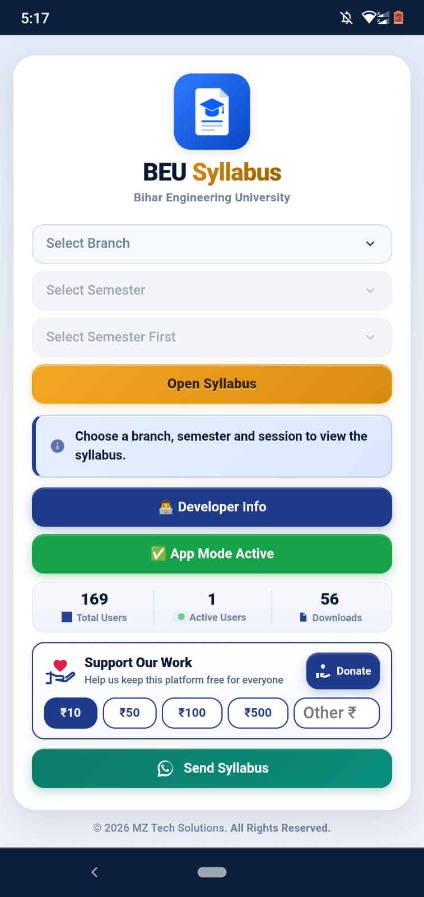
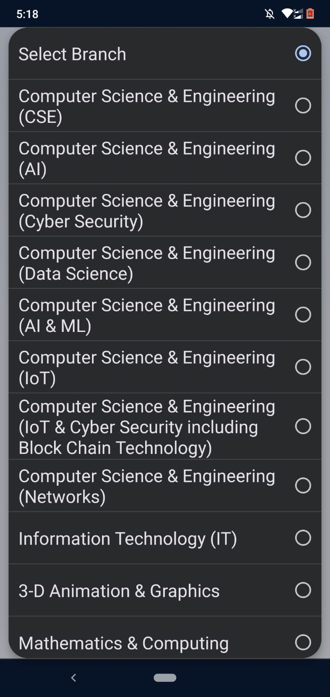
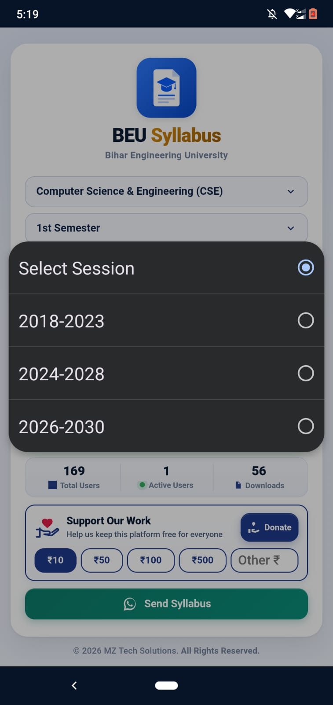

# 📚 BEU Syllabus App

<p align="center">
  
</p>

<h1 align="center">BEU Syllabus App</h1>

<p align="center">
<b>One Place for All Bihar Engineering University B.Tech Syllabus</b>
</p>

<p align="center">
<a href="https://mdzafar864.github.io/BEU-Syllabus-App/">

</a>


</p>

---

## 📖 About

**BEU Syllabus App** is a modern **Progressive Web Application (PWA)** developed for students of **Bihar Engineering University (BEU)**.

It provides **Branch-wise** and **Semester-wise** B.Tech syllabus PDFs with an easy-to-use interface. Students can instantly preview and download the latest syllabus from any device.

---

## ✨ Features

- 📚 Branch-wise Syllabus
- 🎓 Semester-wise Navigation
- 📄 PDF Preview
- 📥 One Click Download
- ⚡ Fast Loading
- 📱 Mobile Friendly
- 💻 Desktop Compatible
- 🌐 Progressive Web App (PWA)
- 🔍 Easy Navigation
- 🎨 Clean Modern UI
- 🚀 GitHub Pages Hosted
- 🔄 Regular Updates

---

## 🎓 Supported Branches

- Computer Science Engineering (CSE)
- Information Technology (IT)
- Artificial Intelligence (AI)
- Artificial Intelligence & Machine Learning (AIML)
- Artificial Intelligence & Data Science (AIDS)
- Civil Engineering (CE)
- Mechanical Engineering (ME)
- Electrical Engineering (EE)
- Electronics & Communication Engineering (ECE)
- Electrical & Electronics Engineering (EEE)
- Internet of Things (IoT)

---

## 📚 Available Semesters

- 1st Semester
- 2nd Semester
- 3rd Semester
- 4th Semester
- 5th Semester
- 6th Semester
- 7th Semester
- 8th Semester

---

## 🛠 Built With

- HTML5
- CSS3
- JavaScript
- Progressive Web App (PWA)
- GitHub Pages

---

## 📂 Project Structure

```text
BEU-Syllabus-App
│
├── index.html
├── css/
│   ├── style.css
│   └── stats.css            (stats bar styles)
├── js/
│   ├── analytics.js
│   ├── app.js
│   ├── data.js
│   ├── config.js            (API URL + tracking settings)
│   ├── tracker.js           (click / action tracking -> MongoDB + GA4)
│   └── stats.js             (stats bar)
├── server/                  (analytics API for MongoDB Atlas, see below)
├── assets/
│   ├── logo.png / logo.svg
│   ├── icon-192.png, icon-512.png            (PWA "any" icons)
│   ├── icon-maskable-192.png, icon-maskable-512.png
│   ├── apple-touch-icon.png
│   ├── favicon.ico, favicon.svg, favicon-96x96.png
│   ├── Developer.png
│   └── screenshots/
├── manifest.json
├── service-worker.js
└── README.md
```

---

## 🚀 Live Demo

🌐 <https://mdzafar864.github.io/BEU-Syllabus-App/>

---

### 📸 Screenshots

<table align="center">
  <tr>
    <td align="center">
      <b>🏠 Home</b><br><br>
      
    </td>
    <td align="center">
      <b>📂 Branch</b><br><br>
      
    </td>
    <td align="center">
      <b>🎓 Semester</b><br><br>
      
    </td>
  </tr>
  <tr>
    <td align="center">
      <b>📅 Session</b><br><br>
      
    </td>
    <td align="center">
      <b>📄 PDF Viewer</b><br><br>
      
    </td>
    <td align="center">
      <b>👨‍💻 Developer Info</b><br><br>
      
    </td>
  </tr>
</table>

---

## 📦 Installation

Clone Repository

```bash
git clone https://github.com/mdzafar864/BEU-Syllabus-App.git
```

Go to Project

```bash
cd BEU-Syllabus-App
```

Open

```text
index.html
```

Or deploy using GitHub Pages.

---

## 🌟 Why Use BEU Syllabus App?

- Free to Use
- Latest BEU Syllabus
- No Login Required
- Responsive Design
- Installable as App
- Fast PDF Loading
- Clean User Interface
- Easy Navigation

---

## 🚀 Future Roadmap

- 🔍 Search Syllabus
- ❤️ Favorite Subjects
- 🌙 Dark Mode
- 📢 Notifications
- 📚 Notes Section
- 📝 Previous Year Questions
- 🤖 Telegram Bot Integration
- 📱 Android App

---

## 📊 Stats Bar & Usage Tracking

A stats bar under the Install / **App Mode Active** button shows **Total Users**, **Active Users** and **Downloads**. Every button click, dropdown change and app action is also saved to **MongoDB Atlas**, next to the existing Google Analytics 4 tracking.

```text
Browser (GitHub Pages) ──► server/ API (Vercel / Render / ...) ──► MongoDB Atlas
   tracker.js, stats.js        POST /api/track   GET /api/stats
```

A static site cannot talk to Atlas directly (the database password would be public), so the small API in [`server/`](./server) sits in between.

### Setup (about 10 minutes)

1. **Atlas**: create a free cluster, a database user, and under *Network Access* allow your API host (Vercel needs `0.0.0.0/0`, so use a strong password).
2. **Deploy `server/`** to Vercel (Root Directory = `server`) or any Node host, with the environment variables from [`server/.env.example`](./server/.env.example). Open `https://YOUR-API/api/health` to check it.
3. **Point the app at it** (two places, same URL):
   - `js/config.js` → `apiBase: "https://YOUR-API"`
   - `index.html` → the same origin in the `connect-src` of the Content Security Policy.
4. Push. Until `apiBase` is set, tracking is off and the bar shows `—`.

The API creates its collections, indexes and default documents automatically the first time it connects to an empty database (details in [`server/README.md`](./server/README.md)).

### What is stored

| Collection | Holds |
| --- | --- |
| `events` | one row per click / change / action (`type`, `name`, `data`, `visitorId`, `sessionId`, time). Auto-deleted after `EVENT_TTL_DAYS` (default 180). |
| `visitors` | one row per anonymous browser id: first / last seen, language, screen. Powers Total and Active users. |
| `counters` | the running Downloads total (kept even after old events expire). |

- **Total users** = distinct anonymous browser ids. **Active users** = seen in the last 5 minutes (`ACTIVE_WINDOW_MINUTES`). **Downloads** = presses of the Download button in the PDF viewer.
- No names, emails or IP addresses are stored. The id is a random value in `localStorage`; clearing site data creates a new one.
- Everything in `events` has `type` = `click`, `change`, `action` (the existing GA4 events, mirrored), `page_view` or `session_start`.
- Raw clicks and dropdown changes are also sent to GA4 as `ui_click` / `ui_select_change`. Set `mirrorUiEventsToGA: false` in `js/config.js` to turn that off.

---

## 🤝 Contributing

Contributions are welcome!

1. Fork Repository
2. Create Branch

   ```bash
   git checkout -b feature-name
   ```

3. Commit

   ```bash
   git commit -m "Added new feature"
   ```

4. Push

   ```bash
   git push origin feature-name
   ```

5. Open Pull Request

---

## 👨‍💻 Developer

<p align="center">

</p>

### Md Zafar

💻 Full Stack Developer

🎓 B.Tech Student

🏫 Bihar Engineering University

🌐 Portfolio

<https://mdzafar864.github.io/Portfolio/>

🐙 GitHub

<https://github.com/mdzafar864>

🌐 Website

<https://mdzafar864.github.io/BEU-Syllabus-App/>

---

## ⭐ Support

If this project helps you,

⭐ Star this Repository

🍴 Fork it

📢 Share it with Friends

❤️ Contribute to Improve It

---

## 📜 License

Licensed under the **MIT License**.

---

## 🙏 Acknowledgements

Special Thanks To

- Bihar Engineering University
- GitHub
- Open Source Community
- All Contributors
- Every BEU Student

---

<p align="center">
⭐ If you find this project useful, please give it a Star!
</p>

<p align="center">
<a href="https://github.com/mdzafar864/BEU-Syllabus-App">⭐ Star Repository</a> •
<a href="https://mdzafar864.github.io/BEU-Syllabus-App/">🌐 Live Demo</a> •
<a href="https://github.com/mdzafar864">🐙 GitHub</a>
</p>

---

<p align="center">
© 2026 MZ Tech Solutions. <b>All Rights Reserved.</b>
</p>
